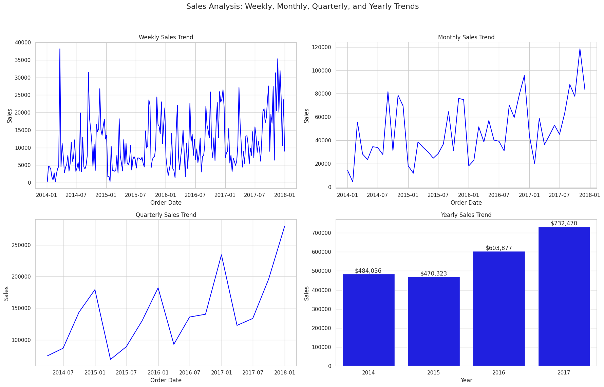
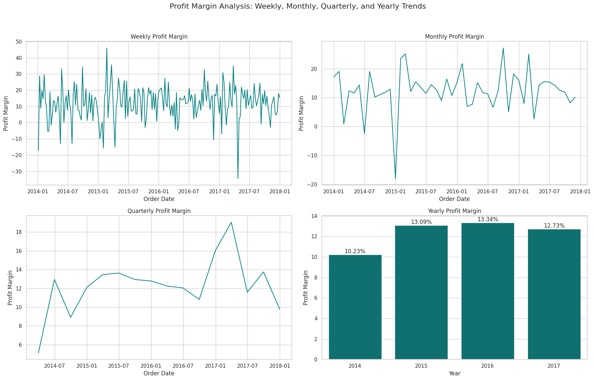
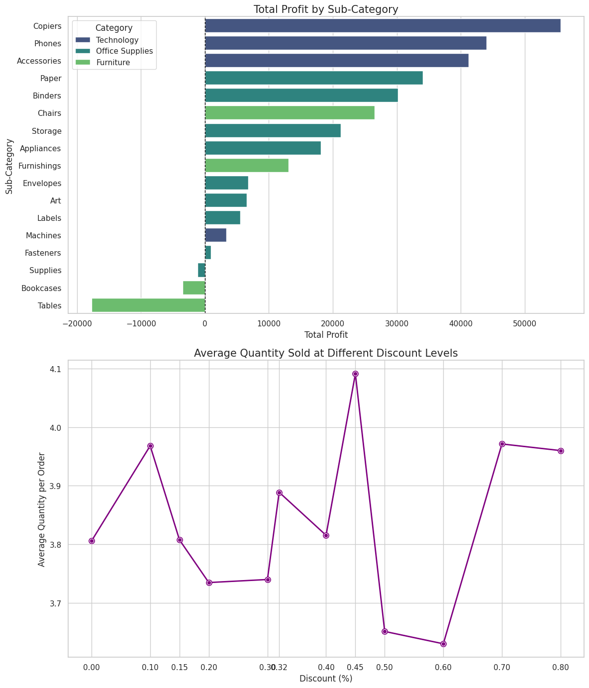

# Superstore Sales Time Series Analysis

A data analysis project on a retail "Superstore" dataset: cleaning and merging three tables, then tracking sales, profit, and KPIs at weekly, monthly, quarterly, and yearly levels.

## Project Overview

The analysis covers **data preprocessing**, **schema integration**, and **time series analysis** to answer questions about sales volatility, profit margins, and return rates across different time granularities.

## Key Findings

- **Sales grew in the last two years.** Yearly sales went from $484,036 (2014) and $470,323 (2015) to $603,877 (2016) and $732,470 (2017).
- **Profit margin did not keep pace.** It rose from 10.23% (2014) to 13.34% (2016), then slipped to 12.73% in 2017 even as sales peaked.
- **Three sub-categories lose money.** Tables, Bookcases, and Supplies show negative total profit, while Copiers, Phones, and Accessories lead.

## Visualizations

**Sales at four time granularities**



**Profit margin over time**



**Profit by sub-category, and quantity sold at each discount level**



## Methodology

### 1. Data Cleaning and Engineering
- **Inconsistency handling:** Detected and standardized inconsistent region labels (for example, correcting 'est' to 'East' and 'wsr' to 'West') so aggregations are accurate.
- **Null handling:** Imputed missing values in the `Returns` dataset to distinguish non-returned items from missing data.
- **Schema merging:** Combined three datasets (`Orders`, `Returns`, `People`) into one analytical dataset using left joins, keeping every order.

### 2. Time Series Analysis
Temporal aggregation with **Pandas resampling**:
- **Sales and profit:** Revenue and profit over time, to identify high-performance quarters.
- **Discount impact:** Average discount rates over time, compared against volume spikes.
- **Quantity:** Units sold, tracked down to the weekly level.

### 3. KPIs
- **Profit margin:** sum of profit divided by sum of sales
- **Average order value**
- **Return rate**

## Tech Stack

- **Python**
- **Pandas** and **NumPy** (data manipulation and merging)
- **Matplotlib** and **Seaborn** (visualization)
- **Jupyter Notebook**

## Repository Structure

```
Data/
  Orders.csv
  People.csv
  Returns.csv
images/                                          charts shown in this README
Superstore_Dataset_Time_Series_Analysis.ipynb    the full analysis
```

## How to Run

1. Clone the repository:
   ```bash
   git clone https://github.com/saleemb94/Superstore-Sales-Time-Series-Analysis.git
   cd Superstore-Sales-Time-Series-Analysis
   ```
2. Install the dependencies:
   ```bash
   pip install pandas numpy matplotlib seaborn jupyter
   ```
3. Open the notebook:
   ```bash
   jupyter notebook Superstore_Dataset_Time_Series_Analysis.ipynb
   ```
4. The notebook was written in Google Colab, so its data paths point to Google Drive. In the data loading cell, change the three paths to `Data/People.csv`, `Data/Returns.csv`, and `Data/Orders.csv`.
